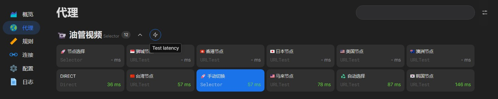
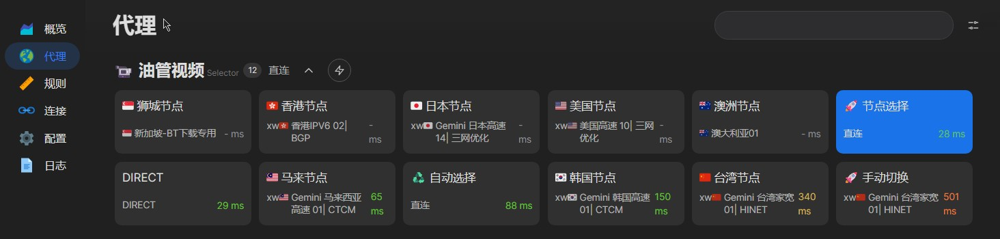

# yacd-plus

> 在 [haishanh/yacd](https://github.com/haishanh/yacd) v0.3.8 基础上做的一处改动：**在代理组卡片上直接显示它当前实际使用的节点**。

原版 YACD 的组卡片只显示「组名 / `Selector`·`URLTest` / 延迟」，子组（如「香港节点」「自动选择」）里到底跑的是哪个节点，需要点进去才知道。这个版本把它显示出来，其余界面、配色、交互一律不动。

> 说明：MetaCubeX 重写过的 [yacd](https://github.com/MetaCubeX/yacd)（0.7.0）原生就有类似能力，但整体 UI 是另一套风格。本仓库的价值在于：**不改变你习惯的经典界面，只补上「当前节点」这一条信息**。

## 效果

每个节点卡片左下角，原本显示类型（`Selector` / `URLTest` / `Direct`）的位置，改为显示该组顺着 `now` 一路走到底的**最终出站节点**。

**修改前**——只能看到 `Selector` / `URLTest` 这类类型，不知道实际在跑哪个节点：



**修改后**——每张卡片直接显示当前节点，长名字折两行且第二行对齐、组标题也显示当前节点：



组标题栏也会在数量徽章前显示当前节点，**折叠状态下也能看到**。

## 改了什么

| 文件 | 改动 |
| --- | --- |
| `src/store/proxies.tsx` | 新增 `getSelectedLeafName()`：顺着 `now` 递归解析到最终节点，带 `seen` 环检测和深度上限（8 层），避免 `GLOBAL` 自引用或组之间互指时死循环 |
| `src/components/proxies/Proxy.tsx` | 卡片左下角显示当前节点名；节点名拆成「前缀 + 名字」两段渲染，实现悬挂缩进 |
| `src/components/proxies/ProxyGroup.tsx` | 把当前节点传给组标题 |
| `src/components/CollapsibleSectionHeader.tsx` | 组标题渲染当前节点 |
| `src/components/proxies/Proxy.module.scss` | 节点名竖排居中、两行截断、悬挂缩进；组名与节点名的字号层级 |
| `src/components/CollapsibleSectionHeader.module.scss` | 标题行当前节点样式 + 手机端布局（标题一行、节点名另起一行） |
| `src/components/proxies/ProxyList.module.scss` | 节点列表改为 CSS Grid：同等宽度；手机端固定每行三列 |
| `src/components/proxies/ProxyLatency.module.scss` | `nowrap`，避免 `103 ms` 被挤成两行 |
| `src/sw.ts` / `src/swRegistration.ts` | Service Worker 加 `skipWaiting()` + `controllerchange` 自动刷新，更新后不再长时间停留在旧面板 |

**没有改动**：路由、i18n、请求层、切换代理逻辑、主题/配色、其余页面（概览/规则/连接/配置/日志）。

## 安装
总结最简单的安装方式：下载解压，替换整个yacd, 名字不能改，必须是yacd

## 使用

### 1. 直接用构建产物

仓库根目录下的 `public/` 就是构建产物，丢到任意静态服务器即可：

```sh
# 把 public/ 里的内容整个替换掉 /usr/share/openclash/ui/yacd（OpenClash 自带的 YACD 面板目录）
scp -r public/* root@192.168.1.1:/usr/share/openclash/ui/yacd/

# 或者先打包，再在路由器上解压覆盖
zip -r yacd-plus.zip public/*
ssh root@192.168.1.1 "cp -r /usr/share/openclash/ui/yacd /usr/share/openclash/ui/yacd.bak"
ssh root@192.168.1.1 "rm -rf /usr/share/openclash/ui/yacd && mkdir -p /usr/share/openclash/ui/yacd"
scp yacd-plus.zip root@192.168.1.1:/tmp/
ssh root@192.168.1.1 "cd /tmp && unzip -o yacd-plus.zip -d /usr/share/openclash/ui/yacd && rm -f /tmp/yacd-plus.zip"
```

> 替换前已自动备份到 `/usr/share/openclash/ui/yacd.bak`，想回退就删掉新目录、把 `.bak` 改回来。
>
> **重要**：替换后浏览器里旧的 Service Worker 可能仍返回旧资源。如果打开还是旧界面，反注册一次 Service Worker 并清站点数据即可（本版之后会自动更新）。

访问时带上面板所需的参数：

```
http://<路由器IP>/ui/yacd/?hostname=<路由器IP>&port=9090&secret=<你的密钥>
```

> 不要用 `file://` 直接打开 `index.html`——模块脚本会被浏览器的 CORS 策略拦掉，页面会是空白。
>
> 如果更新后仍显示旧界面：打开 F12 → Application → Service Workers → Unregister，再 Clear site data。本版已加入自动更新逻辑，清一次之后就不会再遇到。

### 2. 从源码构建

```sh
pnpm install
pnpm build      # 产物输出到 public/
```

> 若 `pnpm install` 后构建报 `Missing "./TwemojiCountryFlags.woff2" specifier`，是因为 pnpm 高版本不再自动应用 `package.json` 里的 `pnpm.patchedDependencies`。手动给 `node_modules/country-flag-emoji-polyfill/package.json` 的 `exports` 补上：
>
> ```json
> "./TwemojiCountryFlags.woff2": "./dist/TwemojiCountryFlags.woff2"
> ```

## 兼容性

- 后端：mihomo / Clash.Meta / OpenClash 的 external-controller 接口
- 浏览器：Chromium 系、Firefox 均可（需要 CSS Grid 与 `-webkit-line-clamp`，后者 Firefox 已支持）
- 依赖节点数据里的 `now` 字段，这是 Clash 标准 API 就有的

## 已知问题

- 组标题栏里「英文前缀 + 国旗 + 中文」混排时，英文（如 `XW`）与中文字形的视觉大小仍有细微差异，这是字体混排的固有现象，暂未处理。

## 致谢与许可

- 原始项目：[haishanh/yacd](https://github.com/haishanh/yacd)（MIT），作者 Haishan
- 本项目同样是 [MIT](LICENSE) 许可，版权声明沿用原项目
- 若上游有更新，建议优先跟随上游；本仓库的改动集中在 `src/components/proxies/`、`src/store/proxies.tsx` 与 `src/sw*.ts`，便于 rebase

## 开发

```sh
pnpm install
pnpm dev        # http://127.0.0.1:3000
pnpm build      # 产物输出到 public/
```
